Step 1: You Need To Download The File You Need. You Can Find It In ⁠[📦 · Kho File](#/files) & ⁠[🤝 · Kho File Cộng Đồng](#/community), Or You Can Download It From Other Sources. It's Up To You.
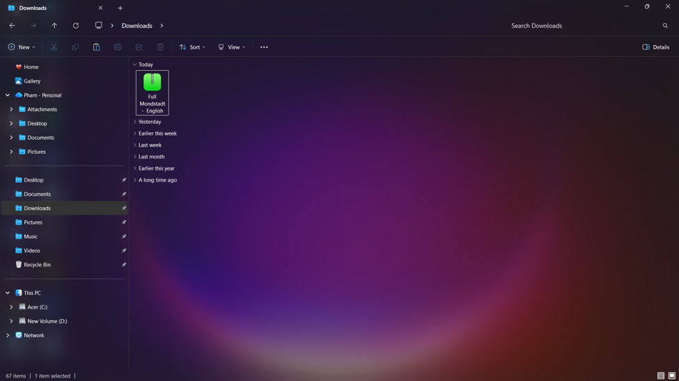
Step 2: You Need To Extract The File, As The Sent Files Are Usually In ZIP Format. Right-Click On The File And Click 'Extract All', A Window Will Appear.
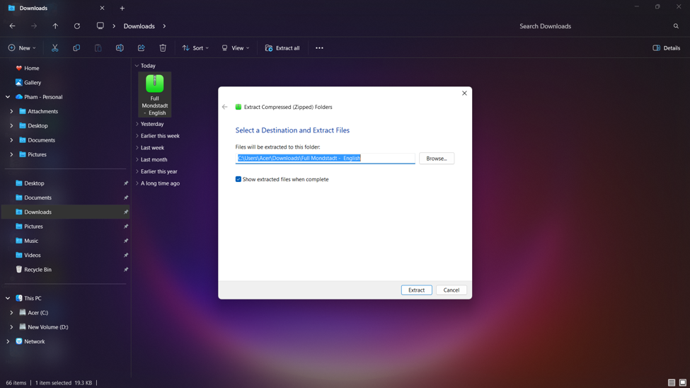
Step 3: After Extracting, A Folder Will Appear. Click On That Folder.
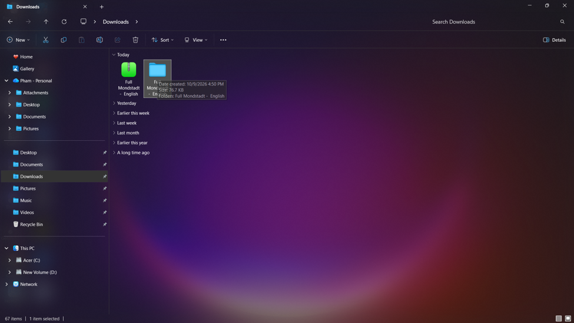
Step 4: Inside The Folder, You Will See A File Like This. Double-Click It To Continue.
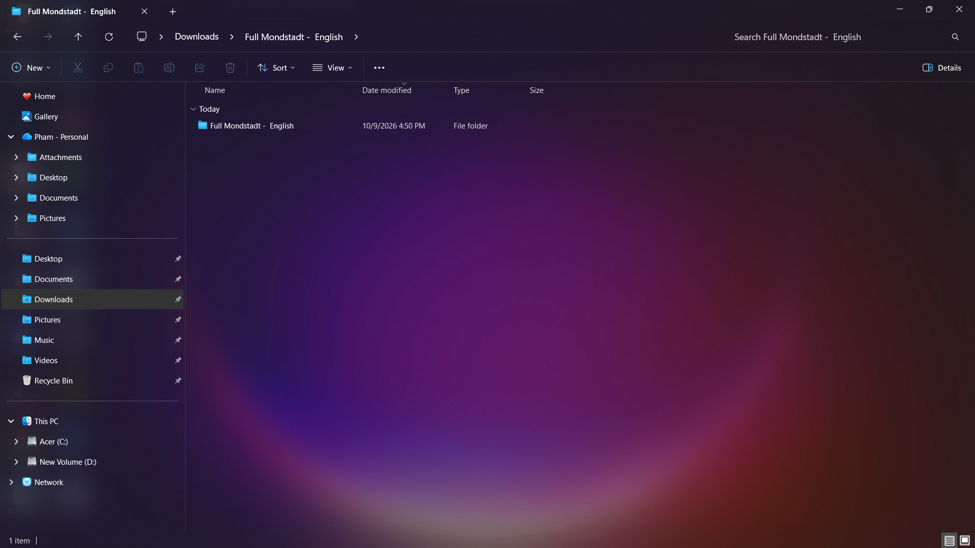
Step 5: Finally, There Will Be 2 Files Inside. Double-Click On 'Readme' To Open It And Read All The Notes Inside Before Moving On To The Next Step.
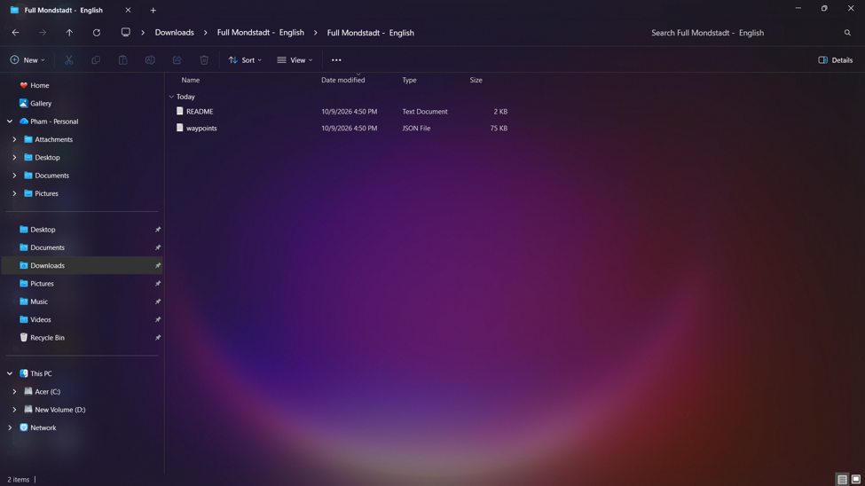
Step 6: Then Right-Click On The Waypoint File And Copy It.
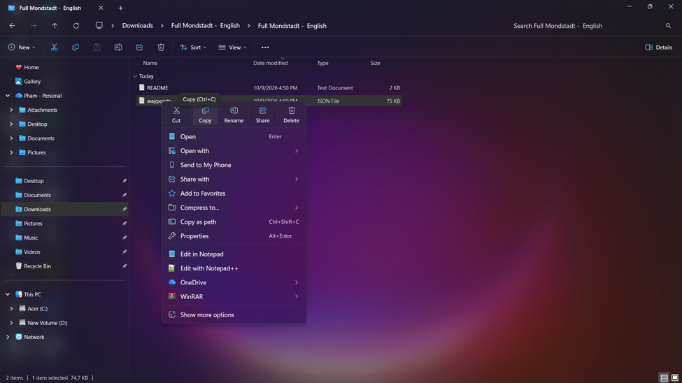
Step 7: After Finishing, Select Drive C:, Then Search For 'Uni' In The Search Bar On The Top Right
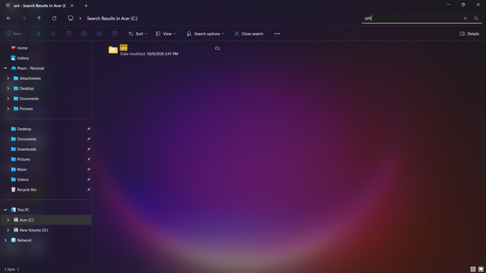
Step 8: Then Open It And You Will See An Interface Like This. Paste The File You Just Copied Here. Only One File Can Be Put Here At A Time
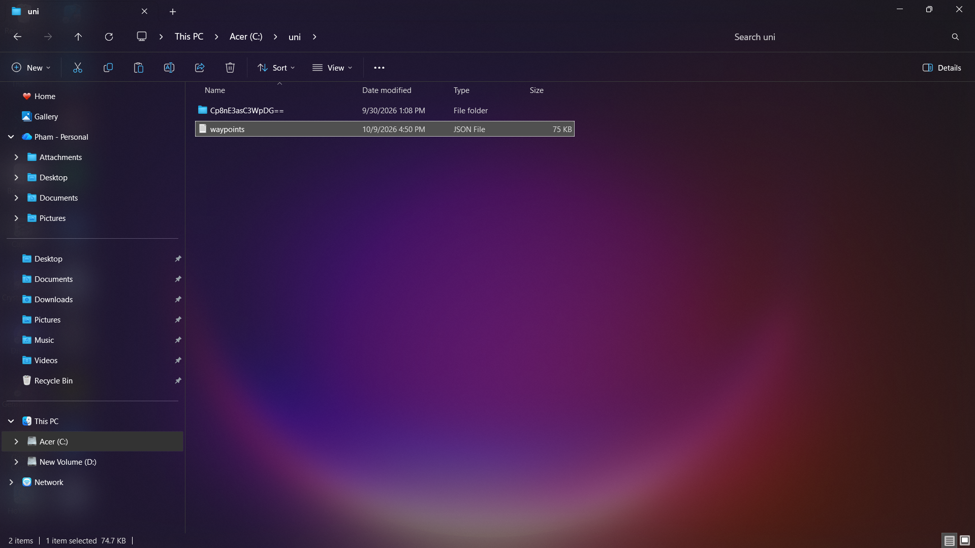
Step 9: Then Launch The Launcher And Enter The Game. After Opening It For The First Time, The Interface Will Look Like This. Switch To The Teleport Tab.
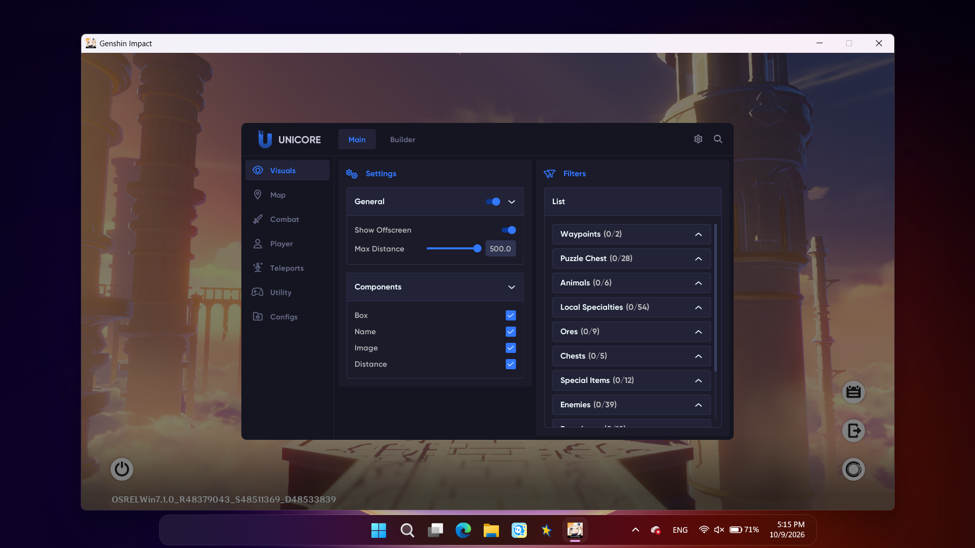
Step 10: Switch To The Warning Tab First And Enable This, Then You Can Use The Teleport Function.
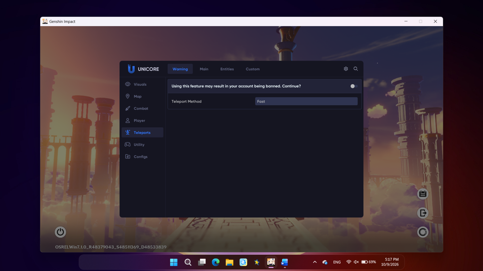
Step 11: After Enabling It, Switch To The Custom Tab, And It Will Look Like This.
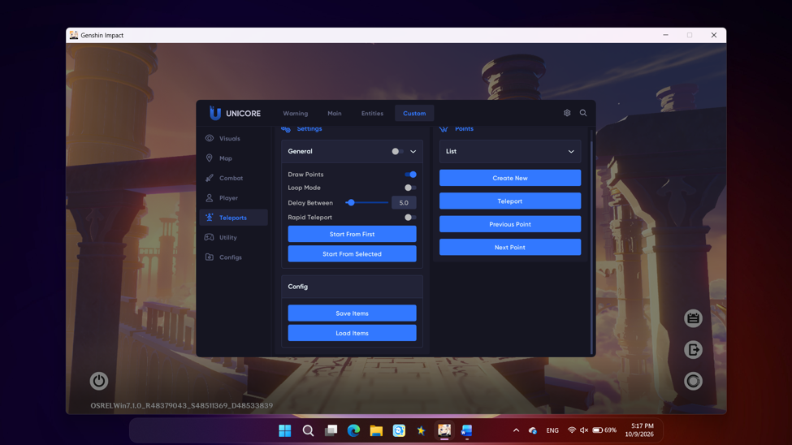
Step 12: An Important Note Is That You Need To Turn On General, Make Sure To Turn It On.
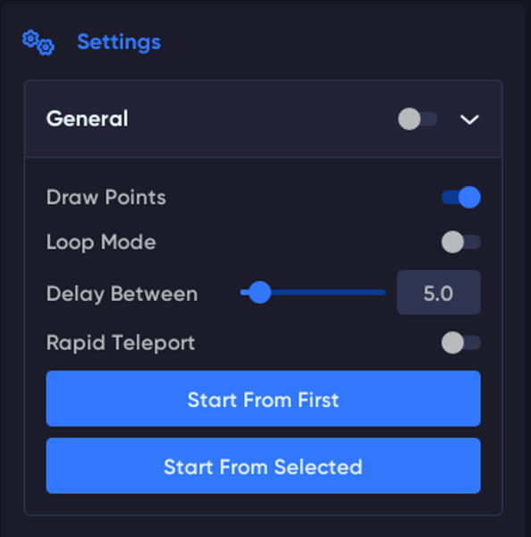
Step 13: After Enabling It, Click 'Load Item' And You Have Completed Loading The File In.
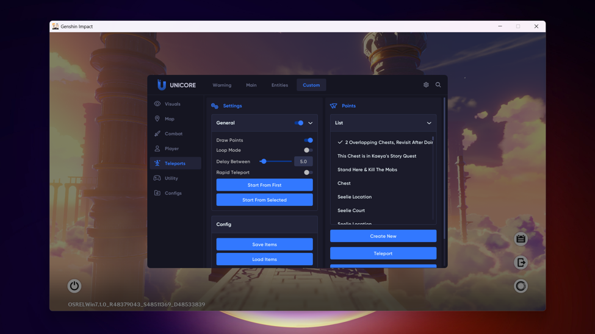
Step 14: I Recommend Keybinding These 3 Buttons By Right-Clicking On Them
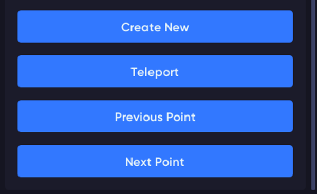
Step 15: Assign The Keys In The Way That Is Most Convenient For You, Or Set Them As Described In The Readme File You Just Read (Or The One You Just Skipped And Are Only Now Opening To Read After Getting Here ==)
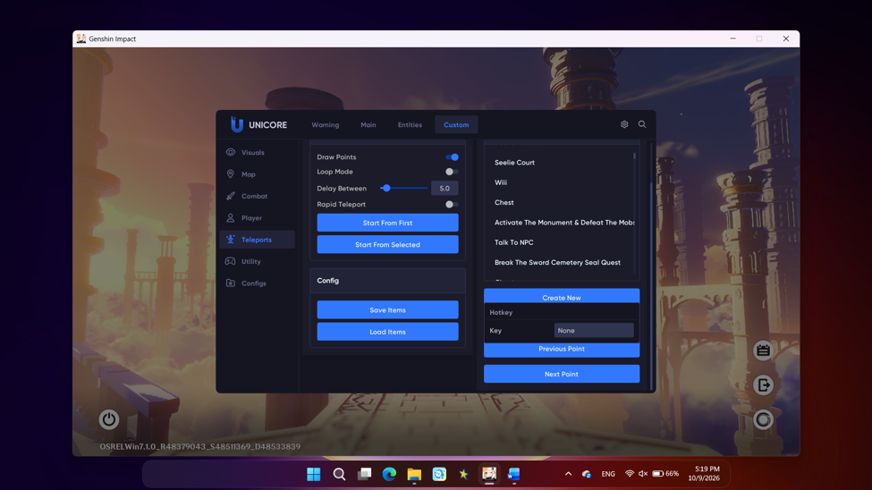
Step 16: You Can Save Your Config To The Config Folder Using The 'Create New' Button. Next Time You Open It, Just Load The Config And All Your Previously Saved Settings Will Be Restored, No Need To Do It Again.
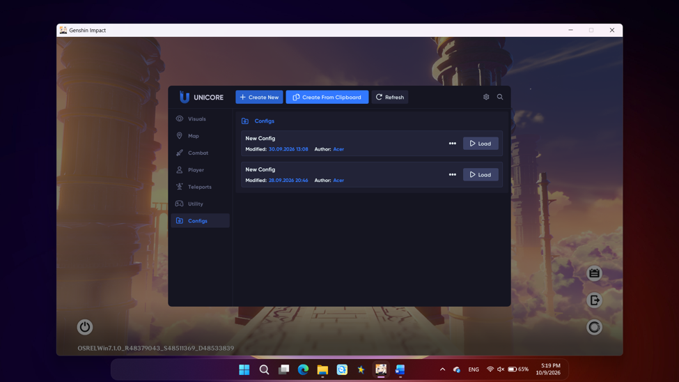
That's All! To Make Running Files More Convenient, You Can Adjust Feature Settings And Enable Other Functions In Uni. Spend A Little Time Checking Each Tab And Sub-Tab To See What Functions Uni Has To Offer.
