Passo 1: Você precisa baixar o arquivo necessário. Você pode encontrá-lo em ⁠[📦 · Arquivos](#/files) e ⁠[🤝 · Arquivos da Comunidade](#/community), ou baixá-lo de outras fontes. Fica a seu critério.
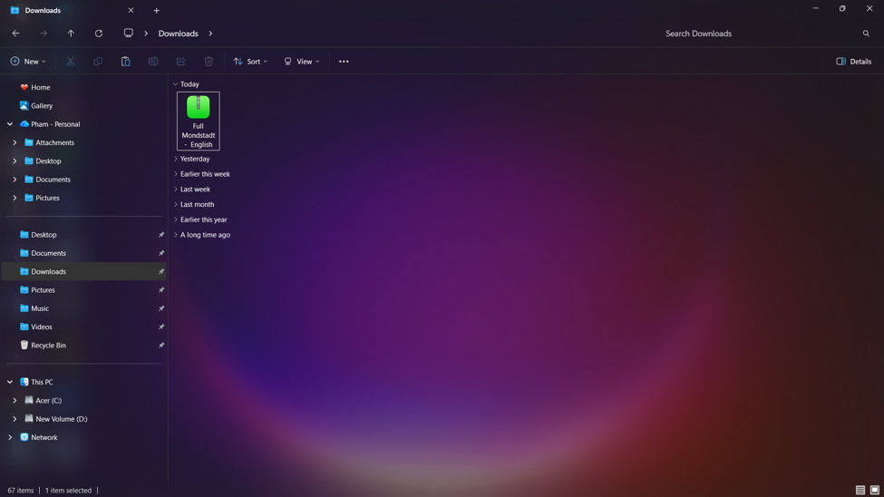
Passo 2: Você precisa extrair o arquivo, pois os arquivos enviados geralmente estão no formato ZIP. Clique com o botão direito no arquivo e clique em 'Extrair tudo'; uma janela aparecerá.
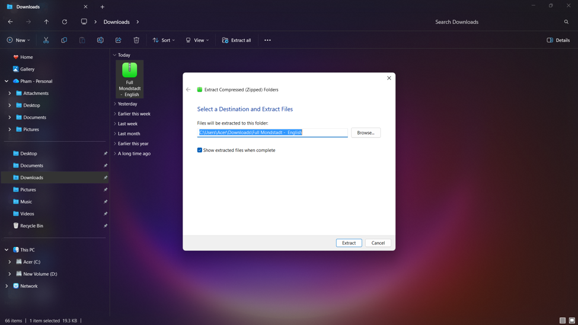
Passo 3: Após extrair, uma pasta aparecerá. Clique nessa pasta.
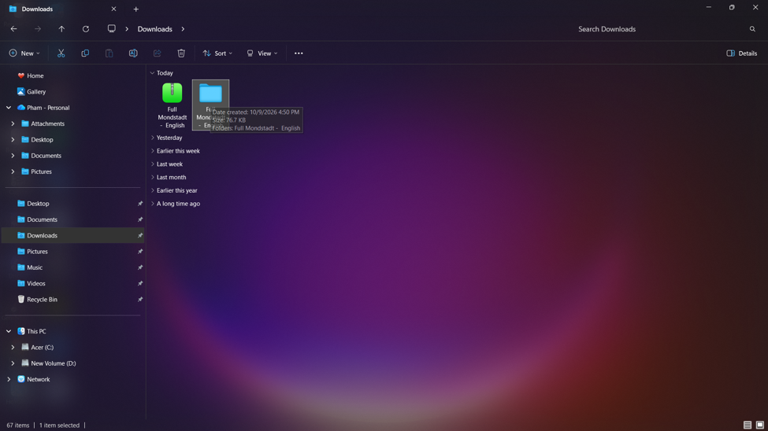
Passo 4: Dentro da pasta, você verá um arquivo como este. Dê um duplo clique nele para continuar.
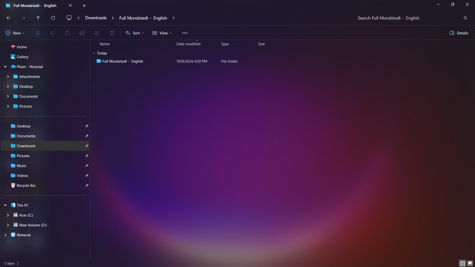
Passo 5: Por fim, haverá 2 arquivos dentro dela. Dê um duplo clique em 'Readme' para abri-lo e leia todas as notas antes de passar para o próximo passo.
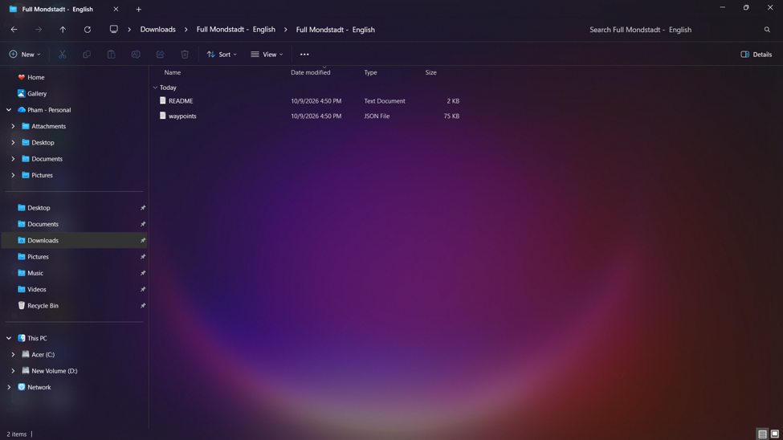
Passo 6: Em seguida, clique com o botão direito no arquivo de waypoints e copie-o.
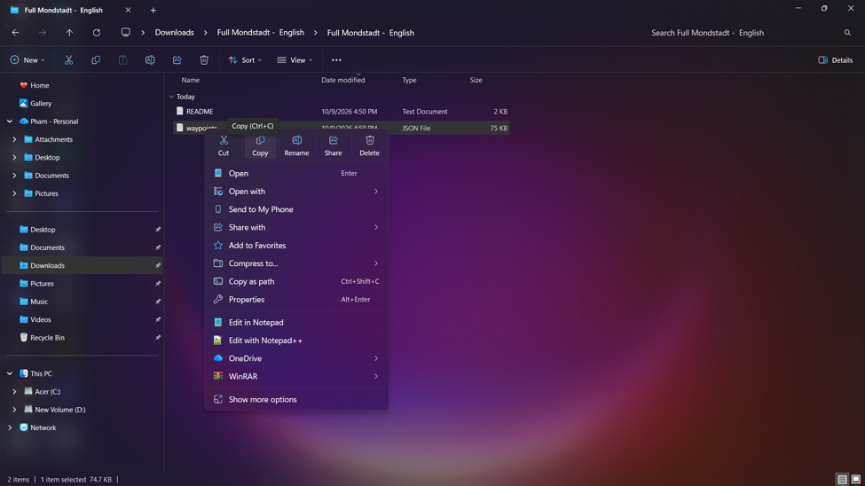
Passo 7: Depois de terminar, selecione o Disco C: e pesquise por 'Uni' na barra de pesquisa no canto superior direito.
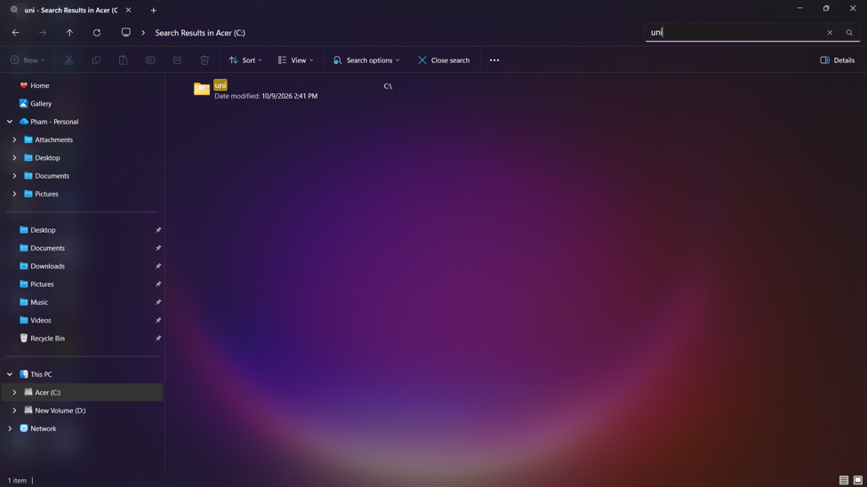
Passo 8: Abra a pasta e você verá uma interface como esta. Cole o arquivo que você acabou de copiar aqui. Apenas um arquivo pode ser colocado aqui por vez.
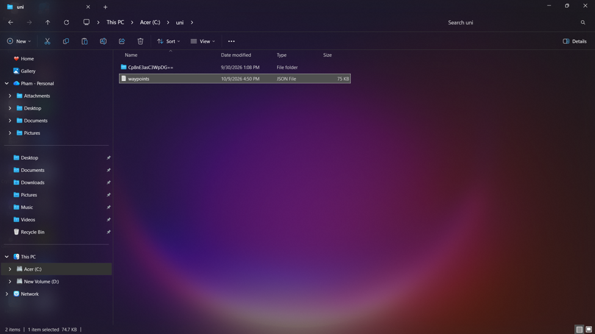
Passo 9: Em seguida, abra o inicializador e entre no jogo. Ao abrir pela primeira vez, a interface será assim. Mude para a aba Teleport.
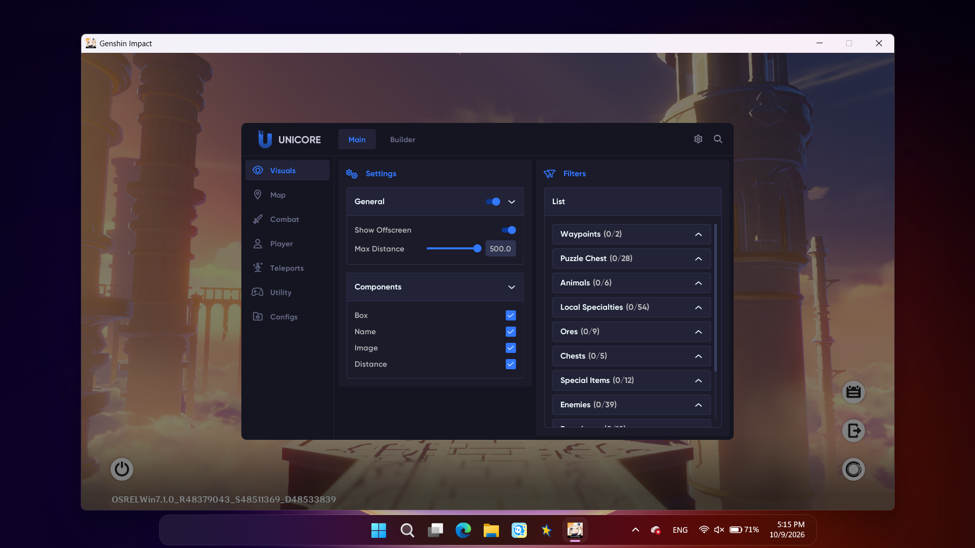
Passo 10: Mude para a aba Warning primeiro e ative esta opção; depois disso, você poderá usar a função de teleporte.
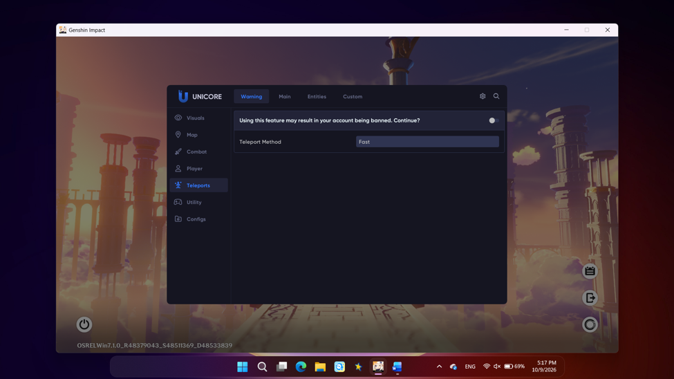
Passo 11: Após ativar, mude para a aba Custom e ela ficará assim.
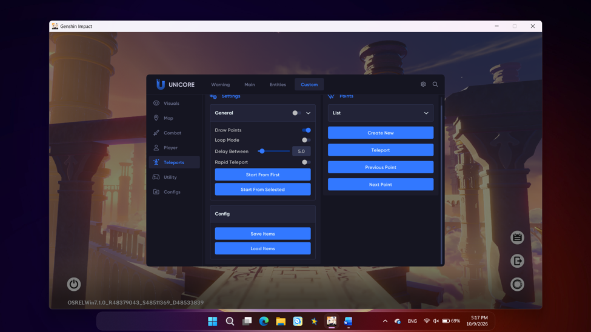
Passo 12: Uma observação importante é que você precisa ativar a opção General, certifique-se de ativá-la.
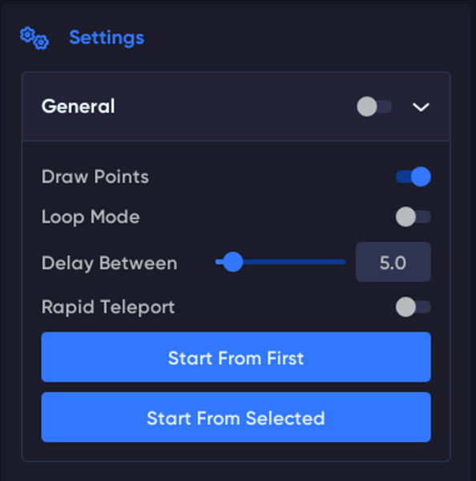
Passo 13: Após ativar, clique em 'Load Item' e você terá concluído o carregamento do arquivo.
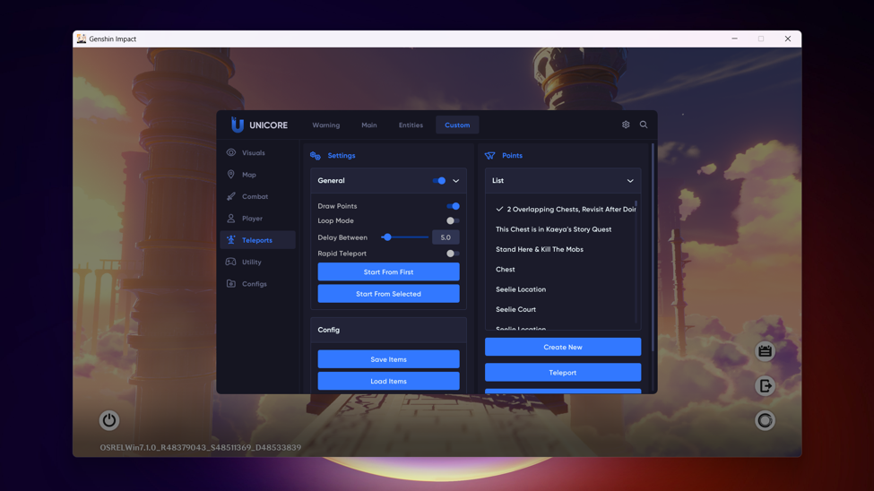
Passo 14: Recomendo configurar atalhos de teclado para estes 3 botões clicando com o botão direito neles.
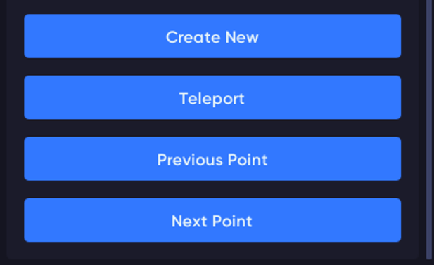
Passo 15: Atribua as teclas da maneira mais conveniente para você, ou defina-as conforme descrito no arquivo Readme que você acabou de ler (ou aquele que você pulou e só agora está abrindo para ler ==).
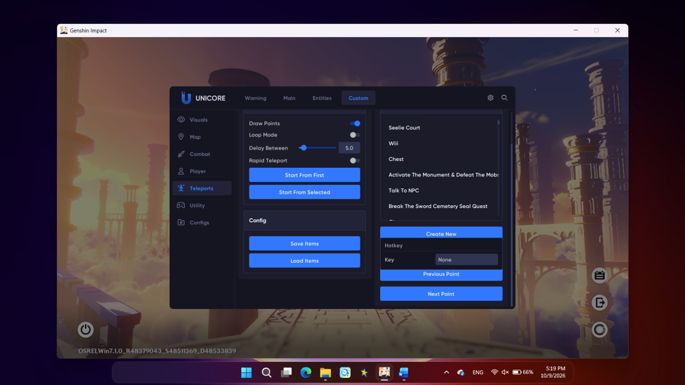
Passo 16: Você pode salvar sua configuração na pasta Config usando o botão 'Create New'. Da próxima vez que abrir, basta carregar a configuração e todas as suas opções salvas anteriormente serão restauradas, sem a necessidade de fazer tudo de novo.
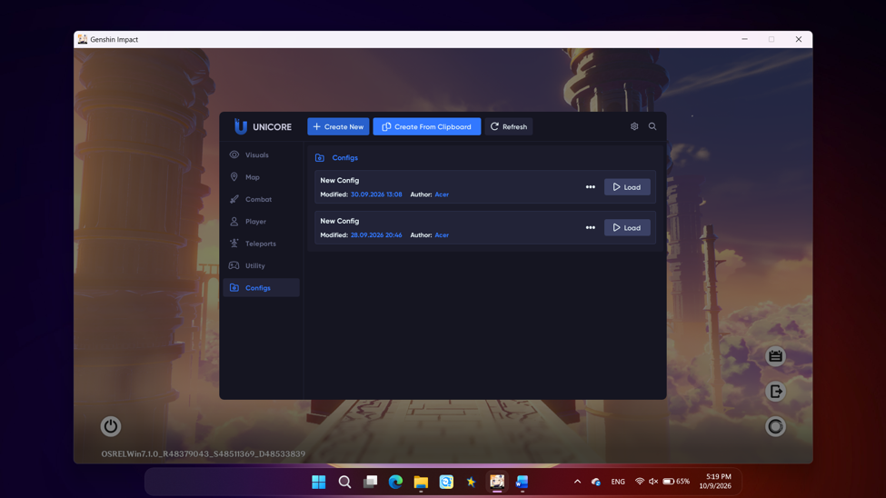
Isso é tudo! Para tornar a execução de arquivos mais conveniente, você pode ajustar as configurações de recursos e ativar outras funções no Uni. Dedique um tempo para verificar cada aba e sub-aba para ver os recursos que o Uni oferece.
