Шаг 1: Вам нужно скачать необходимый файл. Вы можете найти его в ⁠[📦 · Хранилище файлов](#/files) и ⁠[🤝 · Файлы сообщества](#/community), либо скачать из других источников. На ваше усмотрение.
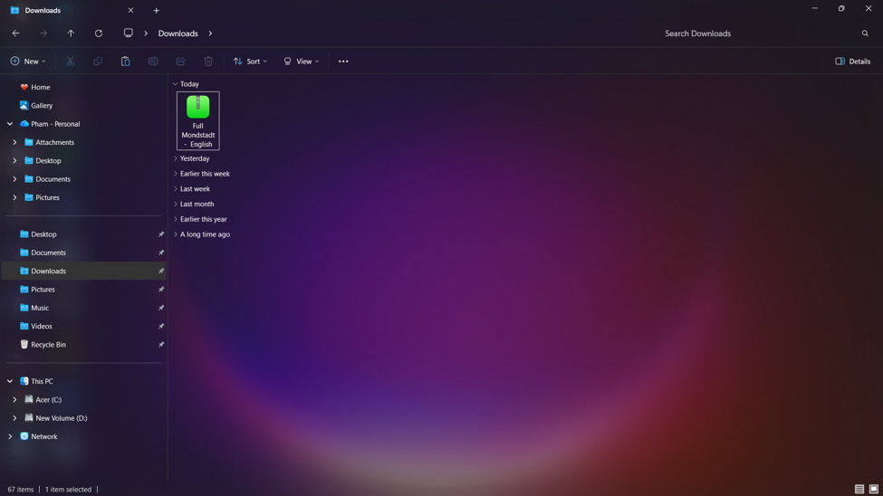
Шаг 2: Распакуйте файл, так как отправляемые файлы обычно находятся в формате ZIP. Нажмите правой кнопкой мыши по файлу и выберите «Извлечь все», после чего появится окно.
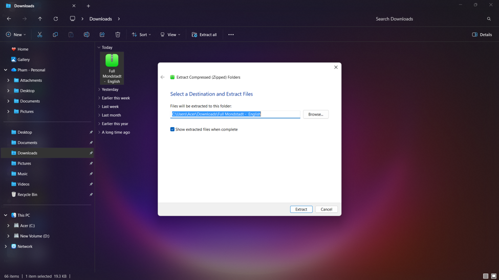
Шаг 3: После извлечения появится папка. Откройте эту папку.
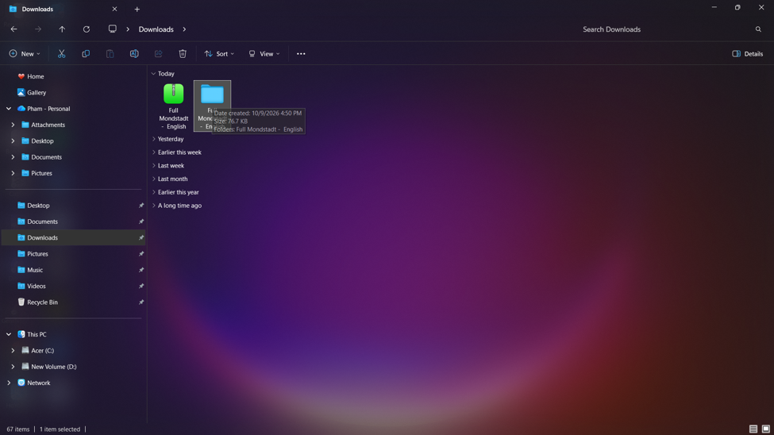
Шаг 4: Внутри папки вы увидите подобный файл. Дважды нажмите на него, чтобы продолжить.
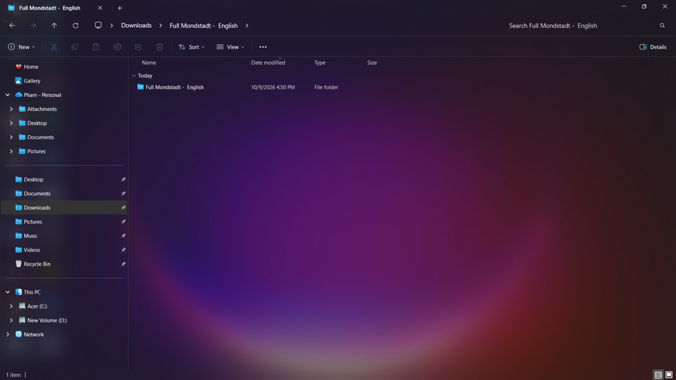
Шаг 5: Внутри будут 2 файла. Дважды нажмите на 'Readme', чтобы открыть его и прочитать все примечания перед переходом к следующему шагу.
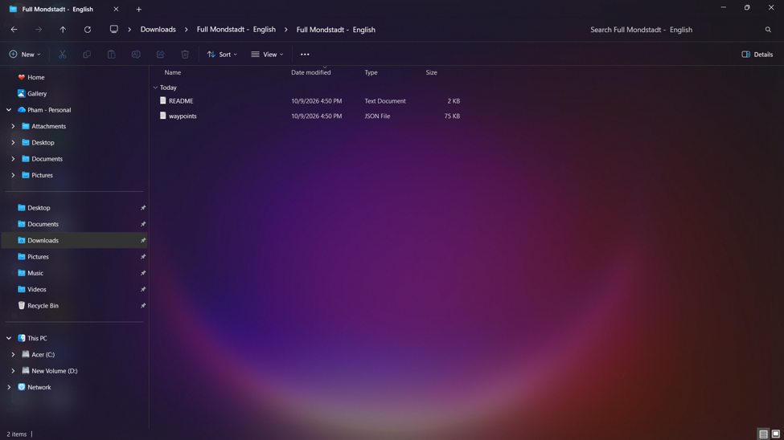
Шаг 6: Затем нажмите правой кнопкой мыши на файл точек телепортации и скопируйте его.
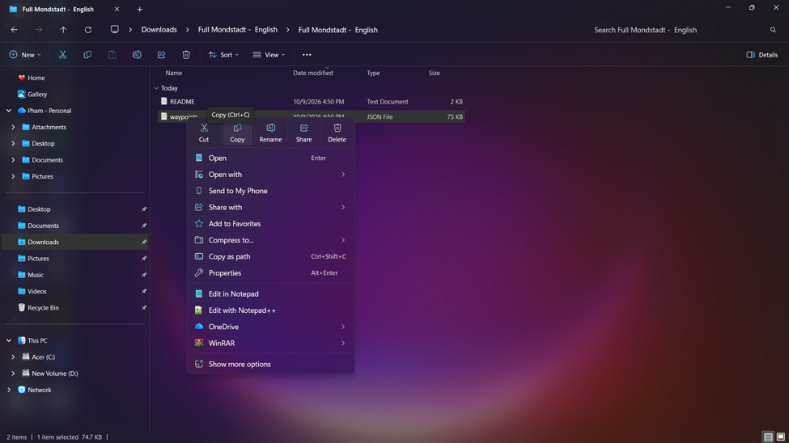
Шаг 7: После этого выберите Диск C: и найдите 'Uni' в строке поиска в правом верхнем углу.
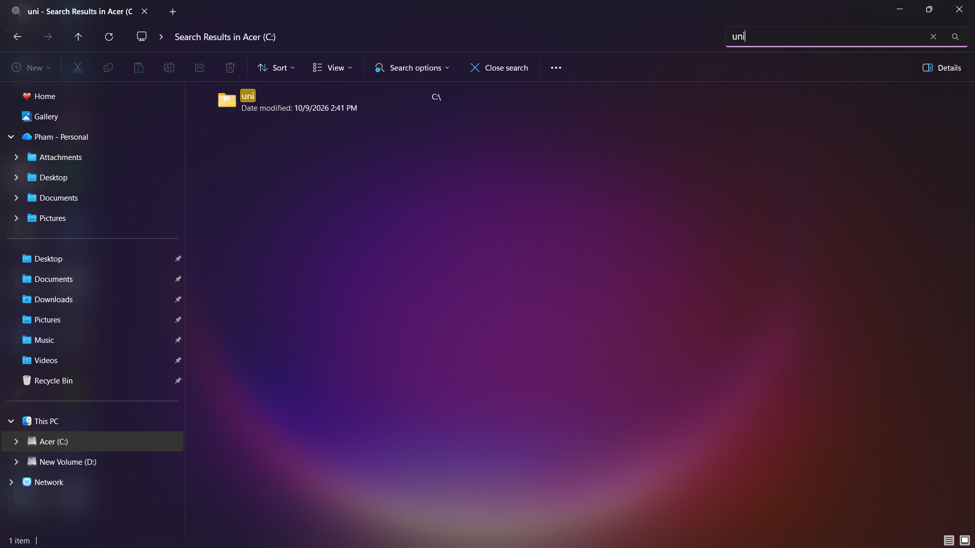
Шаг 8: Откройте её, и вы увидите следующий интерфейс. Вставьте скопированный файл сюда. Одновременно сюда можно поместить только один файл.
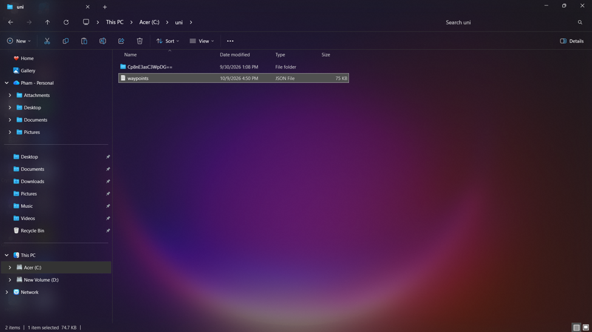
Шаг 9: Затем запустите лаунчер и войдите в игру. При первом открытии интерфейс будет выглядеть так. Перейдите на вкладку Teleport.
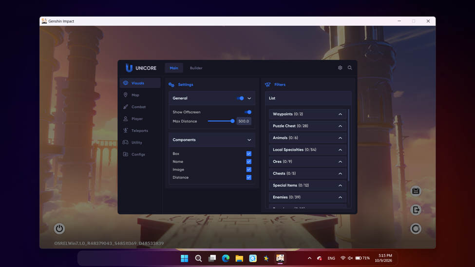
Шаг 10: Сначала перейдите на вкладку Warning и включите эту функцию, после чего вы сможете использовать телепортацию.
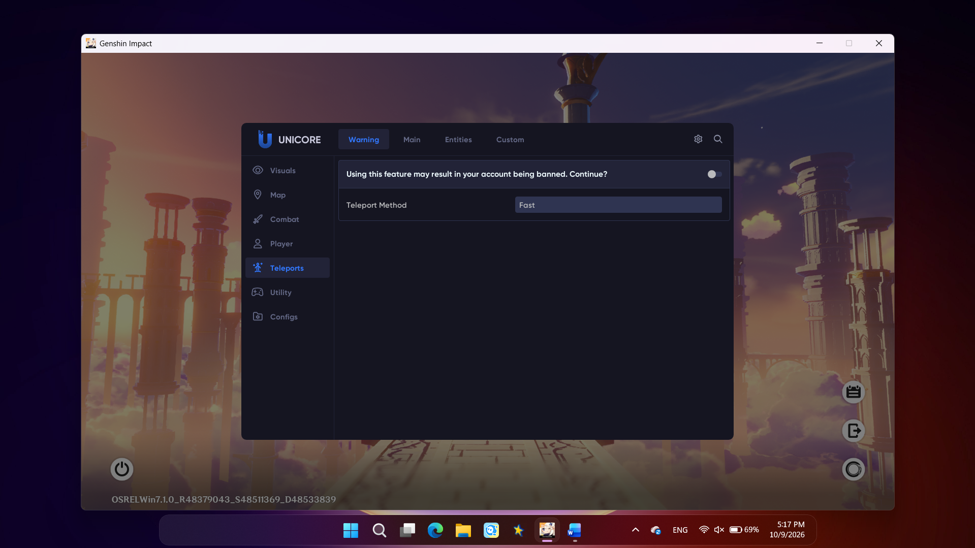
Шаг 11: После включения перейдите на вкладку Custom, и она будет выглядеть следующим образом.
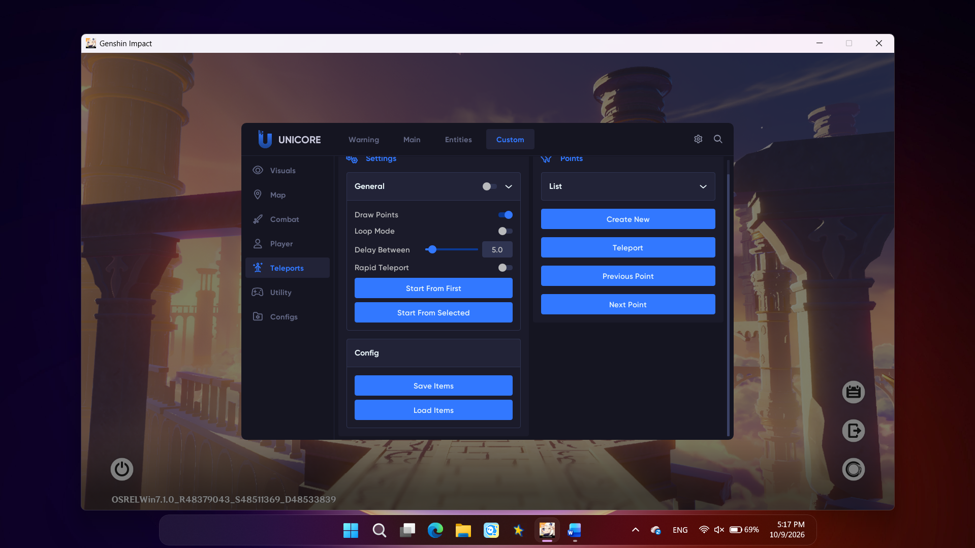
Шаг 12: Важное примечание: обязательно включите параметр General.
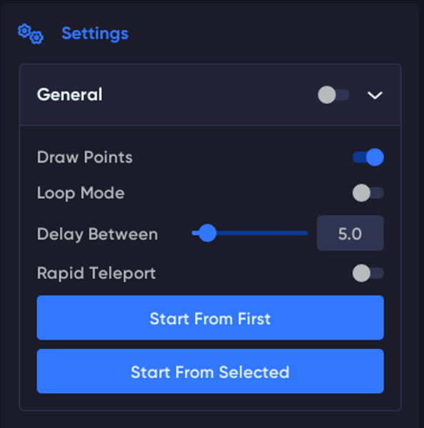
Шаг 13: После включения нажмите 'Load Item', и загрузка файла будет завершена.
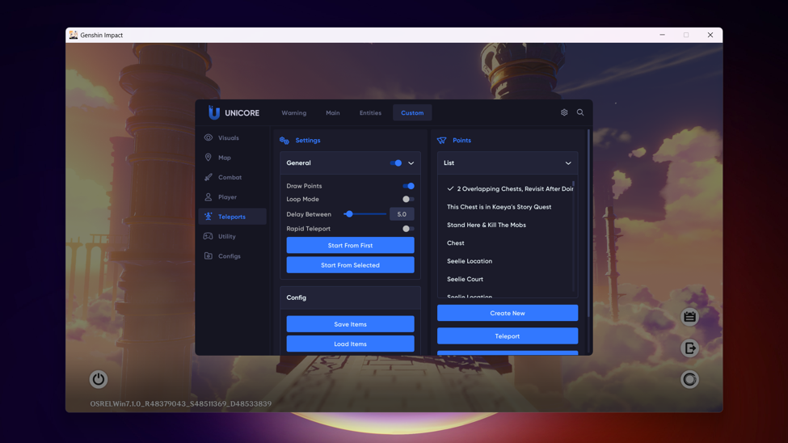
Шаг 14: Рекомендуется назначить горячие клавиши для этих 3 кнопок, нажав на них правой кнопкой мыши.
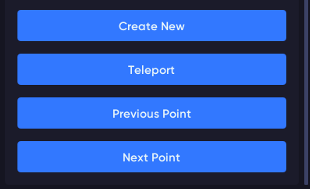
Шаг 15: Назначьте клавиши так, как вам удобно, или настройте их, как описано в прочитанном файле Readme (или том, который вы пропустили и открываете только сейчас ==).
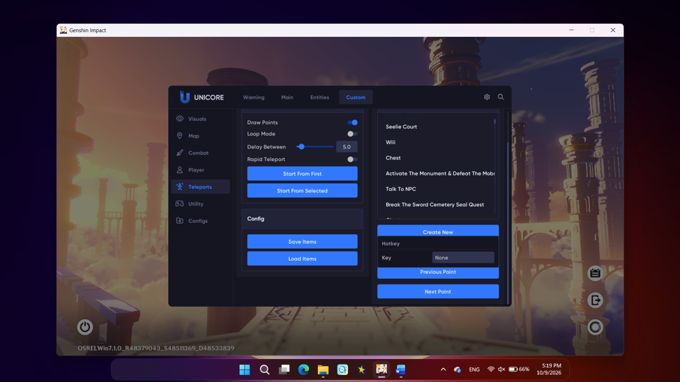
Шаг 16: Вы можете сохранить свой конфиг в папку Config с помощью кнопки 'Create New'. В следующий раз просто загрузите конфиг, и все сохранённые настройки восстановятся без необходимости настраивать заново.
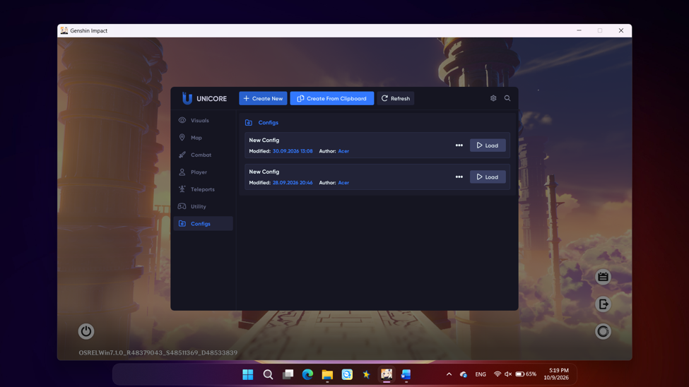
Вот и всё! Для более удобного использования файлов вы можете настроить параметры функций и включить другие возможности в Uni. Потратьте немного времени на просмотр каждой вкладки и подвкладки, чтобы узнать о функциях Uni.
